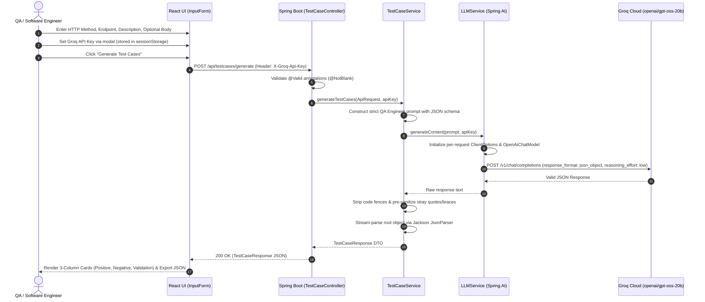

README.md
# TestPilot AI 🚀

**An AI-Powered REST API Test Case Generator**

TestPilot AI is a modern developer tool designed to automate exhaustive REST API test suite creation. By providing an HTTP method, endpoint path, description, and an optional sample JSON request body, the application leverages **Spring AI** connected to high-speed inference on **Groq Cloud (`openai/gpt-oss-20b`)** to generate categorized positive, negative, and validation test cases with expected HTTP status mappings.

---

## 🎯 Project Highlights

1. **Spring AI 2.0 Integration:** Built using modern **Spring AI** (`spring-ai-starter-model-openai`), utilizing Spring AI's fluent `ChatClient` and `OpenAiChatModel` configured with native `JSON_OBJECT` response formatting and low reasoning effort to ensure deterministic, fast JSON outputs.
2. **Stateless & Confidential Key Management:** Groq API keys are supplied on-demand per request by the user via the `X-Groq-Api-Key` HTTP header. The backend never persists or logs keys, scoping client instances strictly to individual request lifecycles.
3. **Multi-Stage Resilient JSON Parsing:** Implements a fail-safe parsing pipeline using Jackson's streaming `JsonParser` along with automatic regex sanitizers (recovering from stray quotes, extra trailing braces, and formatting slips) to guarantee that the UI never breaks.
4. **Postman-Inspired Dark Interface:** Pure React 18 and modular Vanilla CSS designed for developer ergonomics with real-time payload tabs, status-coded badges, and instant JSON exports.
5. **Clean Layered Architecture:** Follows strict separation of concerns: Controller $\rightarrow$ Orchestration Service $\rightarrow$ Spring AI Inference Layer $\rightarrow$ Global Exception Handling.

---

## ⚙️ Architecture & Data Flow

### 1. System Architecture Diagram

```mermaid
graph TD
    subgraph Client ["Frontend (React 18 + Vite)"]
        UI["Postman-Style UI"]
        Modal["API Key Modal (Session Storage)"]
        AxiosClient["Axios HTTP Client"]
    end

    subgraph Backend ["Backend (Spring Boot 4 + Spring AI)"]
        Controller["TestCaseController (/api/testcases)"]
        Validator["Jakarta Bean Validation"]
        Service["TestCaseService (Prompt & Parser)"]
        LLM["LLMService (Spring AI ChatClient)"]
        SpringAI["OpenAiChatModel (Scoped per Request)"]
        Parser["Jackson Streaming JsonParser + Sanitizer"]
        GlobalEx["GlobalExceptionHandler"]
    end

    subgraph Cloud ["Groq Cloud Inference"]
        GroqAPI["Groq OpenAI-Compatible API (/v1/chat/completions)"]
        Model["openai/gpt-oss-20b"]
    end

    UI -->|1. Submit Details & Key| AxiosClient
    AxiosClient -->|2. POST /api/testcases/generate with X-Groq-Api-Key| Controller
    Controller -->|3. Validate Payload| Validator
    Validator -->|4. Valid Request| Service
    Service -->|5. Build QA Persona Prompt| LLM
    LLM -->|6. Build OpenAiChatModel with User Key| SpringAI
    SpringAI -->|7. ChatClient.prompt().call()| GroqAPI
    GroqAPI --> Model
    Model --> GroqAPI
    GroqAPI -->|8. Raw JSON Output| SpringAI
    SpringAI -->|9. Response String| Service
    Service -->|10. Stream Token Parse & Sanitize| Parser
    Parser -->|11. Structured TestCaseResponse DTO| Controller
    Controller -->|12. 200 OK JSON Response| AxiosClient
    AxiosClient -->|13. Render 3-Column Test Grid| UI
```

---

### 2. End-to-End Execution Flow



---

## 🛠️ Technology Stack

### Backend
| Technology | Specification | Purpose |
| :--- | :--- | :--- |
| **Java** | 21+ | Core runtime language |
| **Spring Boot** | 4.x (`spring-boot-starter-web`) | REST API container and dependency injection |
| **Spring AI** | 2.0.0 (`spring-ai-starter-model-openai`) | `ChatClient` fluent API, `OpenAiChatModel` client |
| **Validation** | `spring-boot-starter-validation` | Declarative request payload validation (`@NotBlank`, `@Valid`) |
| **JSON Engine** | Jackson 2.x / 3.x (`jackson-databind`) | Streaming JSON deserialization (`JsonParser`) and schema mapping |
| **Inference Engine** | Groq Cloud (`openai/gpt-oss-20b`) | Ultra-fast token generation via OpenAI-compatible endpoint |
| **Build Tool** | Apache Maven 3.9+ | Dependency resolution and build lifecycle management |

### Frontend
| Technology | Specification | Purpose |
| :--- | :--- | :--- |
| **React** | 18.3.1 | Declarative component architecture and state management |
| **Vite** | 5.3.1 | Build tooling and development proxy server (`/api` $\rightarrow$ `8080`) |
| **Axios** | 1.7.2 | Promise-based HTTP client with 60-second generation timeout |
| **Vanilla CSS** | CSS3 Custom Properties (Variables) | Postman-inspired dark developer theme |
| **Typography** | Inter & JetBrains Mono | Monospace code styling and readable UI typography |

---

## 📁 Project Structure

```text
SmartAPITester/
├── backend/                               # Spring Boot Application
│   ├── pom.xml                            # Spring AI BOM, starters & dependencies
│   └── src/
│       └── main/
│           ├── java/com/testpilot/
│           │   ├── TestPilotApplication.java       # Bootstrap application entry
│           │   ├── config/
│           │   │   └── CorsConfig.java             # Cross-Origin (CORS) rules
│           │   ├── controller/
│           │   │   └── TestCaseController.java     # REST endpoints (/generate, /download)
│           │   ├── dto/                            # Data Transfer Objects
│           │   │   ├── ApiRequest.java             # Incoming request payload
│           │   │   ├── TestCase.java               # Single scenario structure
│           │   │   ├── ExpectedResponse.java       # Status code prediction
│           │   │   └── TestCaseResponse.java       # Aggregated response structure
│           │   ├── exception/
│           │   │   ├── GlobalExceptionHandler.java # Unified error responses
│           │   │   └── LLMException.java           # Custom exception for AI failures
│           │   └── service/
│           │       ├── LLMService.java             # Spring AI ChatClient integration
│           │       └── TestCaseService.java        # QA prompt builder & stream parsing
│           └── resources/
│               └── application.properties          # Server port, Groq base URL, logging
│
└── frontend/                              # React 18 Application (Vite)
    ├── package.json                       # Dependencies & scripts
    ├── vite.config.js                     # Proxy forwarding /api to port 8080
    └── src/
        ├── main.jsx                       # Application bootstrap
        ├── App.jsx                        # Master layout, state & scrolling
        ├── index.css                      # Global dark theme tokens & reset
        ├── components/
        │   ├── ApiKeyModal.jsx            # Secure in-browser API key manager
        │   ├── InputForm.jsx              # Postman-style URL bar, method selector & tabs
        │   └── ResultSection.jsx          # 3-column test cards, status chips & export
        └── services/
            └── apiService.js              # Axios instance with request interceptors
```

---

## 🚀 Local Setup & Execution

### 1. Prerequisites
- **Java JDK:** 21 or higher (`java -version`)
- **Node.js & npm:** Node 18+ and npm 9+ (`node -v`, `npm -v`)
- **Groq API Key:** Free key from [Groq Console](https://console.groq.com/keys)

---

### 2. Start Backend (Spring Boot)
1. Navigate to the `backend` directory:
   ```bash
   cd backend
   ```
2. Run the application:
   ```bash
   mvn spring-boot:run
   ```
   *The backend starts on `http://localhost:8080`.*

---

### 3. Start Frontend (React)
1. Open a new terminal and navigate to `frontend`:
   ```bash
   cd frontend
   ```
2. Install dependencies:
   ```bash
   npm install
   ```
3. Start the Vite development server:
   ```bash
   npm run dev
   ```
   *The frontend starts on `http://localhost:5173` with automatic API reverse-proxying.*

---

### 4. Running a Test Generation
1. Open `http://localhost:5173` in your browser.
2. Click **"Set API Key"** in the top navigation and paste your Groq API key (`gsk_...`).
3. Select an HTTP method (e.g. `POST`, `GET`, `PUT`, `DELETE`).
4. Enter an endpoint path (e.g. `/api/v1/users`).
5. Provide a short functional description of the endpoint.
6. *(Optional)* Paste a sample JSON request body in the **Body** tab.
7. Click **"Generate Test Cases"** to view and download your full test suite.

---

## 🔮 Live Demo
🌐 **[Try TestPilot AI Live](https://test-pilot-ai-beryl.vercel.app/)**
